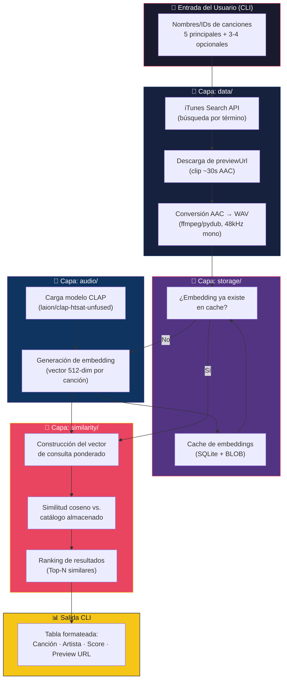

# Plan de Implementación: Buscador de Canciones Similares por Embeddings

## Resumen del Proyecto

Aplicación CLI personal que, dado un conjunto de canciones de entrada (5 principales + 3-4 opcionales), genera un vector de consulta ponderado a partir de embeddings de audio (CLAP) y busca canciones similares por similitud coseno sobre un catálogo construido progresivamente desde iTunes Search API.

---

## 1. Diagrama de Flujo de Datos



### Flujo paso a paso

1. **El usuario invoca el CLI** con los nombres de las canciones (5 principales, 0-4 opcionales)
2. **`data/`** busca cada canción en iTunes Search API, selecciona el match más relevante, y descarga el preview de ~30s
3. **`audio/`** convierte el audio a WAV 48kHz mono y lo pasa por CLAP para obtener un embedding de 512 dimensiones
4. **`storage/`** cachea el embedding indexado por un ID único (iTunes `trackId`) para evitar recomputar
5. **`similarity/`** construye el vector de consulta como combinación lineal ponderada y calcula similitud coseno contra todos los embeddings del catálogo
6. **`cli/`** formatea y muestra el ranking de los Top-N resultados

---

## 2. Requerimientos No Funcionales

| Categoría | Requisito | Detalle |
|:---|:---|:---|
| **Rendimiento** | Inferencia CLAP por canción | < 10s en CPU (Ryzen 5 5500U). Aceptable para uso personal. |
| **Rendimiento** | Búsqueda de similitud | < 1s para catálogos de hasta 1,000 embeddings. |
| **Disponibilidad** | iTunes API rate limit | 20 req/min por IP. Se implementa throttling con `time.sleep(3)` entre requests. |
| **Resiliencia** | Fallback API | Si iTunes falla (404/429), reintentar con backoff exponencial (3 intentos). Si persiste, avisar al usuario y continuar con las canciones que sí resolvieron. |
| **Almacenamiento** | Cache de embeddings | Cada embedding ≈ 2 KB (512 floats × 4 bytes). 1,000 canciones ≈ 2 MB. Trivial en disco. |
| **Reproducibilidad** | Determinismo | Misma entrada → mismo ranking (CLAP en modo eval, seed fijo para cualquier operación aleatoria). |
| **Mantenibilidad** | Modularidad | Cada capa es un paquete Python independiente con interfaz clara. Tests unitarios por capa. |
| **Portabilidad** | Dependencias | Solo Python 3.10+, pip, y ffmpeg en PATH. Sin Docker, sin servicios externos. |
| **Seguridad** | Datos locales | Todo corre local. No se envían datos personales a ningún servicio (iTunes API solo recibe queries de búsqueda textuales). |

---

## 3. Resolución de Puntos Pendientes

Los siguientes ítems estaban marcados como "pendientes / no resueltos" en el documento de contexto. Aquí se propone una resolución para cada uno:

### 3.1 Estructura del CLI: Comandos y Argumentos

```bash
# Comando principal: buscar canciones similares
python -m proyecto_similitud search \
  --main "Canción 1" "Canción 2" "Canción 3" "Canción 4" "Canción 5" \
  --optional "Canción extra 1" "Canción extra 2" \
  --top 10 \
  --country US

# Comando de utilidad: construir/ampliar catálogo
python -m proyecto_similitud catalog \
  --artist "Radiohead" \
  --limit 20

# Comando de utilidad: validar que CLAP funciona en este hardware
python -m proyecto_similitud healthcheck
```

> [!NOTE]
> **✅ Decisión confirmada:** Se usa `--main` como flag explícito (más claro) y se incluye el subcomando `catalog` separado para llenar el catálogo manualmente.

### 3.2 Diseño del Cache (storage)

**Propuesta: SQLite** (una sola base de datos `.db`).

| Alternativa | Pros | Contras |
|:---|:---|:---|
| JSON | Legible, editable | Lento para buscar, no escala, no concurrente |
| Pickle | Rápido serializar | Inseguro, frágil entre versiones de Python |
| **SQLite** ✅ | Atómico, sin servidor, queryable, robusto | Marginalmente más complejo que JSON |

**Esquema propuesto:**

```sql
CREATE TABLE IF NOT EXISTS embeddings (
    track_id    INTEGER PRIMARY KEY,  -- iTunes trackId
    track_name  TEXT NOT NULL,
    artist_name TEXT NOT NULL,
    album_name  TEXT,
    preview_url TEXT,
    embedding   BLOB NOT NULL,        -- numpy array serializado
    model_id    TEXT DEFAULT 'clap-htsat-unfused',
    created_at  TIMESTAMP DEFAULT CURRENT_TIMESTAMP
);
```

### 3.3 Ponderación Numérica

**Propuesta de pesos por defecto:**

| Tipo de canción | Peso | Justificación |
|:---|:---|:---|
| Principal (5 canciones) | `1.0` cada una | Son la referencia primaria del "sonido buscado" |
| Opcional (hasta 4) | `0.4` cada una | Aportan contexto pero no deben dominar la dirección |

**Fórmula del vector de consulta:**

```
q = normalize( Σ(w_i × e_i) )
  = normalize( 1.0·e₁ + 1.0·e₂ + ... + 1.0·e₅ + 0.4·e₆ + 0.4·e₇ + ... )
```

Se normaliza el resultado (L2) antes de calcular similitud coseno. Estos pesos serán configurables vía flags del CLI (`--weight-main`, `--weight-optional`) para experimentar.

> [!NOTE]
> La suma ponderada + normalización es equivalente a un "centroide ponderado" en el espacio de embeddings. Es el approach más simple y robusto para empezar.

### 3.4 Validación de CLAP en Hardware Real

Se incluye como **Fase 0** del checklist: un script `healthcheck` dedicado que:
1. Descarga un preview de prueba desde iTunes
2. Lo convierte a WAV 48kHz
3. Lo pasa por CLAP y mide tiempo de inferencia
4. Reporta: tiempo, uso de RAM, tamaño del embedding

Si tarda > 30s por canción o consume > 16 GB RAM → se activa el Plan B.

### 3.5 Plan B (Fallback si CLAP no funciona bien)

**Propuesta:** Librosa como fallback con feature vector manual.

| Escenario | Acción |
|:---|:---|
| CLAP tarda > 30s/canción | Intentar con ONNX Runtime (cuantización) |
| CLAP + ONNX sigue lento | Cambiar a Librosa (MFCC + chroma + tempo → vector ~40-dim) |
| CLAP da embeddings poco discriminativos | Complementar CLAP con features de Librosa (concatenar vectores) |

La interfaz de `audio/` se diseña con un protocolo/interfaz abstracta para que cambiar de CLAP a Librosa sea solo cambiar la implementación, sin tocar `similarity/` ni `cli/`.

---

## 4. Propuesta de Cambios: Checklist de Desarrollo Paso a Paso

### Fase 0: Setup del Entorno y Validación de Hardware

#### [NEW] [pyproject.toml](file:///home/isaacben/Documents/Project-music-line/pyproject.toml)
- Configuración del proyecto Python con dependencias:
  - `transformers`, `torch` (CPU), `librosa`, `soundfile` — para CLAP
  - `numpy`, `scipy` — para álgebra lineal
  - `requests` — para iTunes API
  - `pydub` — para conversión de audio
  - `click` — para CLI
  - `rich` — para tablas bonitas en terminal
  - `pytest` — para tests
- Requiere `ffmpeg` en PATH (documentar en README)

#### [NEW] [README.md](file:///home/isaacben/Documents/Project-music-line/README.md)
- Instrucciones de instalación (`pip install -e .`, `ffmpeg`)
- Ejemplos de uso de cada comando CLI
- Descripción de la arquitectura

#### [NEW] Script healthcheck
- Descarga un preview de prueba, corre CLAP, mide tiempo y RAM
- Si falla → error claro con instrucciones del Plan B

---

### Fase 1: Capa `data/` — Búsqueda y Descarga

#### [NEW] [data/\_\_init\_\_.py](file:///home/isaacben/Documents/Project-music-line/proyecto_similitud/data/__init__.py)
#### [NEW] [data/itunes_client.py](file:///home/isaacben/Documents/Project-music-line/proyecto_similitud/data/itunes_client.py)
- Función `search_tracks(query, country, limit)` → lista de dicts con metadata + `previewUrl`
- Throttling automático (sleep entre requests)
- Retry con backoff exponencial (3 intentos)
- Logging claro de errores

#### [NEW] [data/preview_downloader.py](file:///home/isaacben/Documents/Project-music-line/proyecto_similitud/data/preview_downloader.py)
- Función `download_preview(preview_url, dest_path)` → path al archivo descargado
- Conversión AAC → WAV 48kHz mono vía pydub/ffmpeg
- Directorio temporal para previews (se limpian después de calcular embedding)

#### Tests para Fase 1
- Test unitario con respuesta mockeada de iTunes
- Test de integración real (1 canción, verificar que se descarga y convierte)

---

### Fase 2: Capa `audio/` — Modelo y Embeddings

#### [NEW] [audio/\_\_init\_\_.py](file:///home/isaacben/Documents/Project-music-line/proyecto_similitud/audio/__init__.py)
#### [NEW] [audio/embedder.py](file:///home/isaacben/Documents/Project-music-line/proyecto_similitud/audio/embedder.py)
- Clase abstracta `AudioEmbedder` con método `embed(audio_path) → np.ndarray`
- Implementación `CLAPEmbedder`:
  - Carga lazy del modelo (solo al primer uso)
  - Preprocesamiento: carga WAV, resampleo a 48kHz si es necesario
  - Retorna vector normalizado de 512 dimensiones
- Implementación futura `LibrosaEmbedder` (placeholder, Fase 5)

#### Tests para Fase 2
- Test con archivo de audio sintético (tono puro generado con numpy)
- Verificar forma del embedding (512,), que está normalizado (norma ≈ 1.0)

---

### Fase 3: Capa `storage/` — Cache de Embeddings

#### [NEW] [storage/\_\_init\_\_.py](file:///home/isaacben/Documents/Project-music-line/proyecto_similitud/storage/__init__.py)
#### [NEW] [storage/cache.py](file:///home/isaacben/Documents/Project-music-line/proyecto_similitud/storage/cache.py)
- Clase `EmbeddingCache`:
  - `__init__(db_path)` — crea/abre SQLite
  - `get(track_id) → np.ndarray | None`
  - `put(track_id, metadata, embedding)`
  - `get_all() → dict[int, np.ndarray]` — para búsqueda exhaustiva
  - `list_tracks() → list[dict]` — para inspección
  - `count() → int`
- Serialización de numpy arrays: `array.tobytes()` / `np.frombuffer()`

#### Tests para Fase 3
- CRUD completo sobre DB en memoria (`:memory:`)
- Verificar roundtrip: guardar embedding → recuperar → comparar arrays

---

### Fase 4: Capa `similarity/` — Motor de Búsqueda

#### [NEW] [similarity/\_\_init\_\_.py](file:///home/isaacben/Documents/Project-music-line/proyecto_similitud/similarity/__init__.py)
#### [NEW] [similarity/engine.py](file:///home/isaacben/Documents/Project-music-line/proyecto_similitud/similarity/engine.py)
- Función `build_query_vector(main_embeddings, optional_embeddings, w_main, w_optional) → np.ndarray`
  - Combinación lineal ponderada + normalización L2
- Función `rank_similar(query_vector, catalog_embeddings, top_n) → list[tuple[track_id, score]]`
  - Similitud coseno vectorizada con numpy (sin necesidad de FAISS para esta escala)
  - Excluye las canciones de entrada del ranking

#### Tests para Fase 4
- Test con vectores sintéticos conocidos (verificar que el ranking es correcto)
- Test de que canciones de entrada se excluyen del resultado

---

### Fase 5: Capa `cli/` — Interfaz de Línea de Comandos

#### [NEW] [cli/\_\_init\_\_.py](file:///home/isaacben/Documents/Project-music-line/proyecto_similitud/cli/__init__.py)
#### [NEW] [cli/commands.py](file:///home/isaacben/Documents/Project-music-line/proyecto_similitud/cli/commands.py)
- Comando `search`: orquesta el pipeline completo (fetch → embed → query → rank → display)
- Comando `catalog`: descarga y embeddea canciones de un artista/búsqueda para ampliar el catálogo
- Comando `healthcheck`: ejecuta el diagnóstico de CLAP
- Usa `click` para parseo de argumentos
- Usa `rich` para tablas con colores y formato en terminal

#### [NEW] [main.py](file:///home/isaacben/Documents/Project-music-line/proyecto_similitud/main.py)
- Entry point: `click.Group` con los 3 subcomandos

---

### Fase 6: Integración End-to-End y Pulido

- **Test E2E manual:** ejecutar `search` con 5 canciones reales, verificar que el output tiene sentido musical
- **Logging:** agregar `logging` a todas las capas (nivel configurable vía `--verbose`)
- **Manejo de errores:** mensajes claros para: canción no encontrada, preview sin URL, timeout de red
- **Limpieza:** eliminar archivos temporales de audio después de cada corrida

---

### Fase 7 (Futura): Mejoras Opcionales

- [ ] Implementar `LibrosaEmbedder` como fallback
- [ ] Agregar búsqueda por texto natural ("algo melancólico con guitarra") usando CLAP text encoder
- [ ] GUI con Streamlit (capa adicional sobre el mismo pipeline)
- [ ] Exportar playlist como archivo `.m3u` o link de Apple Music

---

## 5. Verificación

### Tests Automatizados
```bash
pytest tests/ -v --tb=short
```

### Verificación Manual
1. `python -m proyecto_similitud healthcheck` → confirmar CLAP funciona y tiempos < 10s
2. `python -m proyecto_similitud catalog --artist "Radiohead" --limit 5` → verificar que se descargan, embeddean y cachean 5 canciones
3. `python -m proyecto_similitud search --main "Karma Police" "Paranoid Android" "Lucky" "Let Down" "No Surprises" --top 5` → verificar ranking coherente

---

## 6. Árbol Final del Proyecto

```
Project-music-line/
├── pyproject.toml
├── README.md
├── Contexto Proyecto Similitud.md    # (ya existe)
├── proyecto_similitud/
│   ├── __init__.py
│   ├── main.py                       # entry point CLI
│   ├── data/
│   │   ├── __init__.py
│   │   ├── itunes_client.py          # búsqueda iTunes API
│   │   └── preview_downloader.py     # descarga + conversión audio
│   ├── audio/
│   │   ├── __init__.py
│   │   └── embedder.py               # CLAP embedder (+ interfaz abstracta)
│   ├── similarity/
│   │   ├── __init__.py
│   │   └── engine.py                 # query ponderada + ranking coseno
│   ├── storage/
│   │   ├── __init__.py
│   │   └── cache.py                  # SQLite cache de embeddings
│   └── cli/
│       ├── __init__.py
│       └── commands.py               # click commands + rich output
├── tests/
│   ├── test_itunes_client.py
│   ├── test_preview_downloader.py
│   ├── test_embedder.py
│   ├── test_cache.py
│   ├── test_engine.py
│   └── test_e2e.py
└── data/                             # directorio runtime
    └── embeddings.db                 # SQLite (generado en runtime)
```
